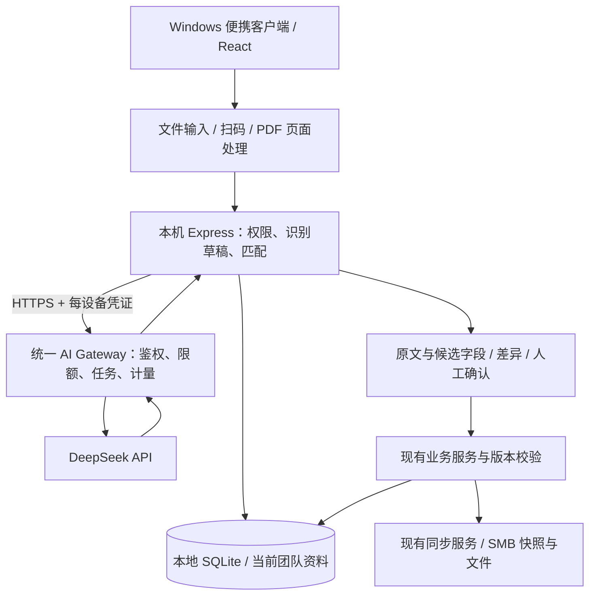

# Vehicle Intelligence Architecture and Implementation Checklist

> **2026-11-09 工作方式更新：** 用户决定在 `yongkang2/vehicle-manager` 的 `codex/ai-assisted-intake` 分支试验智能录入，不再维护独立的 vehicle-intelligence 仓库。分支基于 `afd3574`（1.6.0），原方案所述补齐 #38–#40 已由此基线满足。以下独立品牌、独立仓库发布和 VehicleIntelligence 数据目录建议不再作为本次要求；试验仍使用隔离测试数据，不接管生产数据。保留完整原功能和统一 AI 服务方向；全面重构、接口合同及具体实施范围尚待确认。本文件保留原架构提案供后续收敛，不能直接作为全部已批准的实施清单。

> **For agentic workers:** REQUIRED SUB-SKILL: Use superpowers:executing-plans to implement approved tasks. This is a first architecture proposal, not an approved execution specification. Resolve the decisions in section 10 before implementation; expand each phase into executable test-first tasks as it begins.

**Goal:** 在完整保留 Vehicle Manager 功能的基础上重构模块边界，增加统一 AI 服务支持的识别、匹配、人工确认录入。

**Architecture:** 保留 Windows 便携客户端、localhost 服务、本地 SQLite 和 SMB 协作；新增独立的团队 AI Gateway。扫码与数据库匹配优先在客户端完成；模型只生成候选字段，不直接修改业务数据库。

**Tech Stack:** 沿用 React、TypeScript、Ant Design、Vite、Node.js 24、Express、SQLite；候选新增 ZXing 解码和 PDF.js；统一服务以现有 Node/TypeScript 技术栈实现，原生 fetch 调用 DeepSeek。

**Spec:** 本文第 1–7 节为待评审架构，第 8–10 节为实施和验收清单。已生效产品行为继续以 docs/design.md、最新上游实现及相应测试为准。批准后将新增行为整合到 docs/design.md，不建立第二份长期设计规范。

## 1. 已核对的基础与范围

核对日期：2026-11-09。参考链接：
- 原仓库主分支：https://github.com/yongkang2/vehicle-manager/commit/afd3574cb7ea873f01457c2c1a4e69690964fdad
- 配置与关联改装：https://github.com/yongkang2/vehicle-manager/pull/38
- 发布验收修复：https://github.com/yongkang2/vehicle-manager/pull/40
- 新仓库：https://github.com/yongkang2/vehicle-intelligence

| 项目 | 核对结果 |
|---|---|
| 原仓库 main | afd3574cb7ea873f01457c2c1a4e69690964fdad，源码 1.6.0 |
| 查询到的 Latest 正式 Release | Vehicle Manager v1.4.0；不能把 main 1.6.0 当作已发布包 |
| 本地新仓库 HEAD | f633fb18459319f4dc7c98c524456cad72c3d3f8，源码 1.5.0 |
| 必须补齐 | #38、#39、#40 的内容；本次仅 fetch 检查，没有合并 |
| 最新上游兼容基线 | SQLite schema 6；business protocol 1–5；backup format 5 / field version 4；读旧备份 1–4 |

“全部功能”定义为：实施启动时锁定的上游 main 的已合并功能、权限、状态流转、数据兼容与交付行为。关闭但未合并的 PR 不自动视为已有功能。实施前重新核对远程，后续上游变化逐项评估，不能在开发中无限漂移基线。

本版假设：仍分发便携包；统一服务仅处理 AI，不接管团队业务数据；“内部数据库”指当前团队工作区。外部企业零件主数据系统尚未确认，不假定存在其接口。

## 2. 架构选择

| 路线 | 好处 | 代价与结论 |
|---|---|---|
| A. 保留本地协作，渐进模块重构 + AI Gateway | 最直接保留离线、便携包和全部既有行为 | 需同时维护客户端和一个轻量服务；推荐 |
| B. 业务数据库、登录、AI 全部集中服务器 | 可形成统一事务和权限边界 | 离线、同步、备份、部署均需重新设计；另立迁移项目才合理 |
| C. 仅在原大文件中插入 API 调用 | 初次改动少 | 无法很好满足整体模块重构；不作为最终架构 |

推荐 A。重构的第一阶段改变代码职责与测试边界，不同时替换框架、数据库和同步协议。用户尚未批准路线，本文不是对集中部署需求的推断。

AI 故障不能阻塞普通登记、DOVE、查询、备份或已支持的离线工作。AI 等待不得占用数据库写事务或 SMB 锁。

## 3. 全功能保留矩阵

每一行都应在开发时细化为“入口、接口、权限、状态、数据、自动化测试、人工验收”映射。通过测试数量不等于已证明功能完整。

| 功能组 | 必保留行为 | 现有代码/测试方向 |
|---|---|---|
| 账户、团队、设备 | 注册登录、中英切换、创建/加入/审批、管理员保护、角色/禁用/撤销 | server/team.ts、app.ts；api/team tests |
| 多工作区 | 连接、切换、断开、会话隔离、过期 workspace token 拒写、待同步保留 | server/workspaces.ts；workspace tests |
| 车辆与表格 | 所有字段、归档、列显隐/排序/宽度/筛选/分页、封面照片 | BusinessApp、RecordEditor、vehicle-table/photo tests |
| 零部件 | HV Battery、eMotor、固定控制器、热管理、自定义类型、安装拆除与必填分类 | shared/business.ts、ComponentSections；component/part tests |
| 配置版本 | 审核、R01…发布、不可变快照、差异比较、未发布变更、类型纳入策略 | configuration-revisions 服务及 tests |
| Vehicle Modification | Requestor/Lead、日期、文件、独立复制、Linked、解绑、影响范围确认、激活门槛 | modifications 服务及 API/backup/service tests |
| 设备和附件 | 设备独立编辑、队列、格式/大小校验、原件下载、失败与未知结果处理 | attachment tests、modification-files tests |
| DOVE | 批量 XLSX、VIN 匹配、缺 VIN 手动关联、原件保留、选择配置来源、旧报告确认 | dove、dove-manual、dove-batch tests |
| 报告 | 检索、选择、原件/ZIP 下载、批量归档、同车同 VIN 比较 | report-archive tests |
| 历史和审计 | 修改原因、字段差异、摘要懒加载、筛选导出、来源追溯 | history tests |
| 同步与恢复 | 离线队列、暂停/恢复、冲突、锁租约、隔离操作、共享发布恢复 | sync/shared-compatibility tests |
| 删除 | 永久删除确认、墓碑、防离线复活、同 VIN 新 UUID、关联改装剩余成员保留 | vehicle-deletion tests |
| 导出备份 | JSON/CSV/模板、原件、团队/本地备份、恢复预览、安全副本、回执、提醒 | backup/restore/csv tests |
| 分发升级 | Windows x64、Start/Stop、浏览器存活管理、快捷方式、版本一致性、解压验收 | packaging/version/data-directory tests |

尤其不能因 AI 导入而绕过配置发布审核、关联改装影响范围、管理员激活或删除保护。AI 不自动发布 R 版本、不自动创建 Linked 关系。

## 4. 识别、匹配、录入流程

### 4.1 输入分流

1. 条码/二维码：优先本地多格式解码，保留码制、原始载荷、文件和页/区域来源。扫描枪按键盘文本输入接入，不需强制模型调用。
2. 人读码：直接输入/粘贴，或上传含印刷编号的照片；照片使用视觉模型提取。
3. 混合标签：保留条码与可见文字两套证据，结果不一致就标记冲突，不能静默任选一个。
4. PDF：优先抽取已有文本；扫描页按选定页渲染为图片再识别。PDF 阅读能力不是“任意长度整本无限上传”。
5. DOVE XLSX：保留现有确定性解析，不改为大模型识别。其它现有附件仍可原样上传，不代表都能智能解析。

候选码制包括 Code 128、Code 39、EAN/UPC、QR、Data Matrix；最终支持清单由真实标签样本验证，不能承诺“所有码”。二维码可能只含 URL、供应商私有码或一段复合字段；不自动访问其中链接，也不把任意载荷默认当序列号。厂商字段规则按实际样本增加。

技术候选：[ZXing](https://github.com/zxing-js/library) 提供一维/二维解码；[PDF.js](https://mozilla.github.io/pdf.js/) 提供 PDF 解析渲染。实际依赖需核对维护状态、许可证、目标 Windows 浏览器与多码样本结果再锁定版本。初期不同时引入 Python OCR 和本地大模型运行时。

### 4.2 模型只生成受约束草稿

拟提取 VIN、part number、serial number、供应商、硬件/软件标识等现有字段。输出包含值、原文片段、文件/页码、来源类型、歧义项；缺失写 null，不猜测。

Gateway 对 JSON 结构、长度和字段白名单做验证；客户端再做业务校验。图片/PDF 内容一律当数据，不执行其中指令；模型不获得 SQL、任意工具调用或业务写权限。所谓模型置信度不能当正确率，界面以证据、规则校验、匹配冲突为依据。

截至本次核对，[DeepSeek 官方图像说明](https://api-docs.deepseek.com/zh-cn/guides/vision/) 支持 deepseek-flash 图片输入。服务上线前用实际账户再验证可用模型和限制；模型名仅在服务端配置。先用非思考模式提取结构化短输出，准确率不达标再比较方案。

### 4.3 匹配在本地当前团队进行

- VIN、序列号先精确匹配；保留前导零，始终按文本处理。原始值与规范化值分别保留。
- 编号的连字符/大小写按已确认规则处理；不得擅自把 O 改成 0。
- 零件号可能跨车辆重复，只能推荐相同型号/类别，不能证明是同一实物或同一安装位置。
- 精确无结果后才提供受限候选；模糊候选展示依据，禁止自动选中后保存。
- 多结果、归档对象、其他车辆已安装对象、标识冲突必须提示；永久删除 UUID 不得复活。
- 只对当前授权工作区检索，不上传整库或跨团队搜索。未知料号不能凭空补出参数。
- 选择对象不代表搬移安装关系。新增、更改字段、安装/拆除仍走各自业务动作。

### 4.4 人工确认与保存

流程：输入材料 → 解码/识别 → 字段映射 → 匹配候选 → 查看原文和现值差异 → 修改/补齐 → 确认保存。

车辆合规等级、控制器类型、电池寿命状态等继续执行现有必填规则；无法从证据判断时要求人工选择。默认不以空值清除旧数据，清除必须明确操作。

每一条识别草稿只提交一个明确的业务动作。批量逐条展示成功/失败/未确认，部分成功不伪装成全批次原子提交。保存前重验用户、工作区 epoch、对象版本、归档/删除状态和功能激活状态。失败保留可修正草稿；过期目标重新匹配。

来源证据：草稿临时存本机；最终确认值记录操作者、原因、原始值/人工修改值、源文件 hash、模型/提示版本和请求 ID。证据保存与业务记录引用须有明确的一致性机制，不能出现“显示已保存但缺记录”。文件入库采用先暂存校验、事务写引用、孤儿文件清理。业务历史/备份/同步的扩展须在兼容性阶段验证，不能随意塞入未验证字段。

## 5. 统一 AI 服务、认证与费用

Gateway 是独立部署包，运行在团队可访问且能访问供应商 API 的服务器/常开电脑。便携包只带地址和客户端功能，不含 DeepSeek Key。客户端仅出站连接；不把现有 localhost 服务开放给整个网络。

首次接入建议使用管理员签发的短时一次性登记码，换取每设备独立、可撤销的随机凭证；服务端存凭证哈希并绑定服务端 tenant/device。凭证保存在该设备本地受限位置，不进入共享目录、业务备份或发行包。正常用户不需要自己申请 AI Key。

这是 AI 消费授权，不是替代现有团队账号的企业级身份。客户端上报的 teamId/userId 不可作为服务端可信授权；初期按服务端登记租户和设备限额，用户 ID 仅作辅助归因。禁用/丢失设备需要在 Gateway 撤销，不能声称现有 SMB 成员禁用会自动即时撤销 AI 凭证。若要求统一用户身份与自动撤权，应接企业 SSO，并单独明确部署前提。

服务端实施：HTTPS、上传内容/大小限制、租户/设备限速、并发上限、日/月预算、任务身份隔离、幂等 requestId、超时与取消、无敏感内容日志。DeepSeek Key 在服务端秘密配置中，允许轮换。

拟采用小型 SQLite 任务/用量表和进程内受限工作队列，先不引入 Redis、消息总线、向量库或 Kubernetes。HTTP 提交返回任务 ID，客户端查询结果；重启后 running 状态改为 uncertain，不盲目重复付费请求。取消不保证供应商尚未产生费用。

预算在发起调用前按最大输出预留额度，结束按实际 usage 结算；并发扣减应原子完成，未知结果保留预留直到核对/过期策略处理。账单以供应商为准；预算限额是本服务的调用保护，不能承诺第三方结算绝对无偏差。跨用户/租户不共用识别结果缓存。

部署成本、API 消费与开发成本分开记录；先以真实样本实测每张标签和每页报告，不把此前估算当预算保证。

## 6. 数据与兼容策略

1. 原有 records、UUID、历史、原件哈希、同步协议与版本门槛保持权威；重构不能重新生成身份。
2. 新应用默认独立数据目录（建议 %LOCALAPPDATA%/VehicleIntelligence/data），不自动接管 VehicleManager/data；快捷方式、服务发现、停止控制也独立。
3. 开发/验收使用虚构数据或隔离备份副本，不直接连接生产 SMB。新旧客户端共写同一团队仅在兼容矩阵通过且满足已激活协议时允许。
4. 同设备升级与另一设备首次安装分开：后者创建新设备身份并重新绑定，不复制凭证、会话和 device identity。
5. 草稿与 AI 凭证不进入团队业务备份；已确认业务来源应随历史/业务备份恢复。新增来源持久化是否需要 schema、业务协议、backup 版本提升，在合同测试后明确；不能先承诺零迁移。
6. 不降低 schema 6 或协议 5。旧客户端无法安全保留新增必要元数据时，通过明确激活/最低版本阻止写入。
7. 导入和升级前完整备份并验证；不宣称新版本备份可给旧程序降级。回退需要原程序与升级前完整数据，且处理升级后的新增工作。
8. 新仓库发行配置、仓库地址、Release 前检和文档链接必须审计，避免向原库发布。现有规则要求 Vehicle Manager Release 标题，若采用新品牌需先同步批准并修改规则，不能默默违背。

## 7. 拟议模块边界与接口

尽量保持既有目录；仅拆分实际承担多种职责的文件，不先全面搬家。

| 范围 | 现有入口 | 拟新增/整理 |
|---|---|---|
| 前端录入 | src/BusinessApp.tsx、RecordEditor.tsx、ComponentSections.tsx | src/intake/：输入、预览、字段映射、确认；复用现有编辑组件 |
| 领域合同 | shared/business.ts、configuration-revisions.ts、modifications.ts | shared/intake.ts：证据/草稿/候选/确认合同；不重复定义业务字段 |
| 本地编排 | server/business-routes.ts、business.ts、workspaces.ts | server/intake/：草稿生命周期、匹配、Gateway 客户端、确认编排 |
| 已有业务 | server/configuration-revisions.ts、modifications.ts、dove.ts、sync.ts | 保持专用服务，不统一成可绕过规则的通用 CRUD |
| AI 服务 | 当前不存在 | ai-gateway/：启动、认证、任务、DeepSeek 适配、用量；独立运行入口与配置 |
| 验证 | test/、scripts/ | intake-* / gateway-* 测试，便携包与服务端分别验收 |

拟议接口（新接口，当前不存在）：
- 本地 POST /api/business/intake/previews：接收文件/扫码文本和目标上下文；返回受当前会话/工作区约束的 draftId。
- 本地 GET /api/business/intake/previews/:id：查询处理状态、证据、候选和字段差异。
- 本地 POST /api/business/intake/previews/:id/commit：明确 action、目标、版本、用户选择、原因与 requestId；调用相应领域服务；返回业务回执。
- 本地 DELETE /api/business/intake/previews/:id：取消未提交草稿，不撤销已成功业务记录。
- Gateway POST /v1/recognitions、GET /v1/recognitions/:id、DELETE /v1/recognitions/:id：异步任务和取消意图，全部按凭证归属授权。

草稿绑定 account/session/workspace epoch；提交回执与业务动作要原子关联。响应丢失用相同 requestId 查回执，不能再次新增。Linked 改装等有专用回执的动作应复用原语义，不在外面套一个会重复提交的“通用事务”。详细字段合同在阶段 3 固化。

## 8. 分阶段实现清单

每个编码阶段执行：先写能揭示行为差异的测试 → 验证失败 → 最小实现 → 目标测试通过 → 全套回归 → 英文说明提交。迁移纯文档阶段不伪造失败测试。

### P0 基线补齐与全功能合同
- [ ] 从最新上游建立 codex/ 开发分支，正常合并所需历史；不覆盖原仓库或移动标签。
- [ ] 核对版本/协议/备份、功能开关，建立上述功能的路由和测试映射。
- [ ] npm ci；npm run check:version；npm test；npm run lint；npm run build；记录基线实际结果与跳过原因。
- [ ] 生成虚构的升级/离线/多团队/关联改装/配置版本样本；保留原始快照作前后比较。
验收：#38–#40 功能进入新分支；无新增功能前已能通过原回归。

### P1 行为等价的模块重构
- [ ] 为会话/权限、普通写入、配置发布、关联改装、同步/恢复边界补充特征测试。
- [ ] 按领域拆分过大的 UI/路由编排；保持 API、存储和权限语义。
- [ ] 每次拆分比较结果、历史、队列、导出和恢复内容，不批量改名或格式化。
验收：新旧版本在同样输入下行为等价；原有入口、性能和可访问性不退化。

### P2 材料样本与解码验证
- [ ] 收集经允许的各类标签、码制、PDF、低清/反光/旋转/多码和相似字符样本；人工标注真值并区分开发与留出集。
- [ ] 验证 ZXing 与 PDF.js；输出明确支持列表和限制，锁定依赖。
- [ ] 验证扫码枪文本输入、普通照片、PDF 文字层和扫描页路径。
验收：每类都有成功/拒识/歧义统计；不能只展示几张成功截图。

### P3 本地草稿和匹配
- [ ] 固化 shared/intake.ts 和本地接口合同，采用伪造识别结果先实现完整人工确认流程。
- [ ] 测试精确/模糊/重复序列号、跨车同零件号、前导零、已归档/删除、切换工作区、过期草稿。
- [ ] 确认动作调用原领域服务，验证版本冲突、丢失响应重试、原件/证据关联。
验收：不调用付费 API 也能证明数据不会误写、越权或重复新增。

### P4 统一 Gateway 与 DeepSeek
- [ ] 实现设备登记/撤销、租户隔离、服务端 Key、HTTPS 部署和管理命令。
- [ ] 实现受限任务队列、幂等、超时/取消、用量和预算预留结算。
- [ ] 用模拟供应商测试 401/429/超时/非法 JSON/超大输出/重启未知结果；再做明确预算内的真实样本验收。
- [ ] 将 API 调用放在本地业务写锁和共享锁之外；重新验证返回时的会话归属。
验收：两个不同客户端共用服务；撤销立即阻止新的 AI 请求；并发不绕过额度；不泄漏 Key。

### P5 智能录入与全功能集成
- [ ] 在车辆与零部件编辑接入识别入口、原文核对、差异/候选与必填补齐，中英双语。
- [ ] 批量按条目报告结果；取消后迟到响应不污染另一个工作区。
- [ ] 确认后产生现有历史与同步操作，配置变更仍需人工发布版本。
- [ ] 保留 DOVE 确定性导入、附件原件、所有独立/Linked 改装操作；不将 AI 成功视为业务保存成功。
验收：图片上传到保存全过程可追溯；无网络/AI 失败仍可手动完成登记。

### P6 兼容、分发和交付
- [ ] 完成独立数据目录、身份/凭证隔离、版本化 API 与最低客户端策略。
- [ ] 用旧备份/新备份、协议开关组合、恢复后共享发布、已删除 VIN 重登记验证升级。
- [ ] 构建无密钥便携包与独立 Gateway 部署产物，审计新仓库 Release 目标。
- [ ] 运行 npm run check:version、npm test、npm run lint、npm run build、npm run test:compatibility；通过后运行 npm run package:portable 并验收最终解压包。
- [ ] 两台真实 Windows 电脑通过实际 SMB 和 Gateway 验证并发编辑、断线恢复、预算、重启和撤销；记录仍未验证范围。
验收：正式产物对应干净提交，版本/标签/唯一 ZIP 一致，记录 SHA 和 SHA-256，不绕过失败检查。

## 9. 统一验收与风险检查

### Review Focus
- 材料里有两套冲突编号：必须展示歧义，不用模型“纠正”后静默关联。（P2/P3/P5）
- 请求过程中换账号/团队、撤销或删除目标：结果不得跨范围读取/提交。（P3/P4）
- 上游成功但本地断线或服务重启：不能自动重复付费或重复新增。（P3/P4）
- 新旧客户端同时访问激活后的共享格式：旧端不得覆盖保护数据。（P0/P6）
- 新品牌程序误用旧数据目录或身份：启动、升级、停服务不能误操作原应用。（P6）

质量门槛：原功能矩阵全部验收；跨团队泄漏/未经确认写入/重复写入为零容忍；关键标识符使用逐字符完全一致率，不能用模糊相似率代替。识别正确率、人工修正率、拒识率、P50/P95 耗时与单次费用均按材料类别统计。具体准确率/耗时目标在样本试验后与用户确定，不提前承诺 99%。

本次只核对源码、PR、Release 元数据和官方技术文档；未运行全套测试、调用用户 AI Key、接触生产数据库或执行重构。上游 PR 报告的 517 tests passed / 2 optional skips 是历史证据，不是本次运行结果。

## 10. 待用户确认的部署与范围

1. 是否采用推荐路线 A：保留便携包与 SMB 协作，额外部署统一 AI Gateway？
2. Gateway 部署在哪台常开设备，客户端是否都可访问它、它是否可访问 DeepSeek；谁管理设备授权和额度？
3. 提供哪些实际标签/PDF 类别作为首轮样本；图片向外部供应商传输是否获准？
4. 匹配范围是否仅当前团队数据；如需企业内部目录，需另提供可用接口及权限。

这些影响落地部署和准确率验证，不阻止先评审本版架构；本次没有据此擅自实施产品改动。
